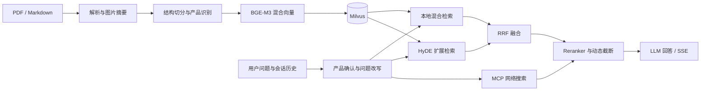

# Dataset RAG · 多模态文档知识库

面向产品手册、设备说明等文档的检索增强问答项目。使用 **LangGraph** 编排文档入库与问答流程，将 PDF / Markdown、图片语义摘要、本地混合检索与 MCP 网络搜索组合起来，提供带过程反馈的流式问答页面。

核心实现是 **BGE-M3 稠密 / 稀疏混合检索 + HyDE 双路召回 + RRF 融合 + Reranker 精排 + 分差动态截断**。仓库同时包含文件上传页面、聊天页面、会话历史和 RAGAS 评估脚本。

## 功能与处理流程

| 模块 | 当前实现 |
| --- | --- |
| 文档入库 | 识别 PDF / Markdown；PDF 通过 MinerU API 转换为 Markdown |
| 图片处理 | 为文档配图生成视觉模型摘要，将图片存到 MinIO，并更新 Markdown 引用 |
| 文档切分 | 按文档结构整理切片，识别对应产品 / 项目名称 |
| 混合向量 | BGE-M3 同时生成稠密和稀疏向量，写入 Milvus |
| 查询处理 | 利用会话历史确认产品名称并改写问题，必要时先向用户澄清 |
| 多路检索 | 原问题检索、HyDE 扩展检索、MCP 网络搜索 |
| 排序与生成 | 两路本地结果先做 RRF 融合，再与网络结果一起精排、截断并生成回答 |
| 交互 | FastAPI 接口、SSE 流式输出、任务状态查询、MongoDB 会话历史 |



“动态截断”按重排结果相邻分数的绝对差或相对差确定保留范围。它是当前代码中的结果筛选策略；效果应结合自己的文档和评估集验证，本文不提供未经测量的准确率指标。

## 技术组成

- **服务与编排**：FastAPI、Uvicorn、LangGraph、LangChain。
- **模型**：OpenAI 兼容接口的文本 / 视觉模型，BGE-M3，BGE Reranker。
- **存储**：Milvus 保存向量切片，MinIO 保存图片，MongoDB 保存聊天历史。
- **外部能力**：MinerU 文档解析接口、支持 `bailian_web_search` 工具的 Streamable HTTP MCP 服务。
- **评估**：仓库提供 RAGAS 基线、完整流程评估及结果比较脚本。

`app/clients/neo4j_utils.py` 中另有 Neo4j 工具；当前两条主图没有接入 Neo4j 入库节点，因此这里不将知识图谱列为已串通的主流程功能。

## 环境准备

Python 版本要求以 [pyproject.toml](pyproject.toml) 为准，当前为 **Python 3.11+**。依赖中包含 PyTorch、模型推理与 PDF 相关组件；CPU / CUDA 环境需要选择相互兼容的安装版本。

启动前自行准备：

1. 可访问的 Milvus、MinIO 和 MongoDB 服务。
2. BGE-M3 与 BGE Reranker 权重及对应本机路径；CPU 可将设备配置为 `cpu` 并关闭 FP16。
3. 文本 / 视觉模型的接口、模型名称和凭据。
4. PDF 入库所需的 MinerU 接口，以及查询流程所需的 MCP 搜索服务。

仓库不附带上述服务、模型权重或可直接使用的服务凭据。

## 安装与配置

以下命令在仓库根目录执行。依赖由 `pyproject.toml` 声明，可使用 [uv](https://docs.astral.sh/uv/guides/projects/) 管理环境：

```powershell
git clone https://github.com/cy180-cy/dataset_rag.git
cd dataset_rag
py -3.11 -m pip install uv
uv sync
```

在根目录创建本地 `.env`，按自己的环境填写。下列内容是字段模板，不是已经部署好的配置：

```dotenv
# 文本 / 视觉模型
OPENAI_BASE_URL=https://your-model-endpoint.example/v1
OPENAI_API_KEY=your-model-api-key
LLM_DEFAULT_MODEL=your-text-model
VL_MODEL=your-vision-model
LLM_DEFAULT_TEMPERATURE=0.1

# 本地模型路径与设备
BGE_M3_PATH=D:/models/bge-m3
BGE_DEVICE=cpu
BGE_FP16=False
BGE_RERANKER_LARGE=D:/models/bge-reranker-large
BGE_RERANKER_DEVICE=cpu
BGE_RERANKER_FP16=False

# Milvus
MILVUS_URL=http://127.0.0.1:19530
CHUNKS_COLLECTION=rag_chunks
ITEM_NAME_COLLECTION=rag_item_names
ENTITY_NAME_COLLECTION=rag_entity_names

# MinIO
MINIO_ENDPOINT=127.0.0.1:9000
MINIO_ACCESS_KEY=your-minio-access-key
MINIO_SECRET_KEY=your-minio-secret-key
MINIO_BUCKET_NAME=rag-images
MINIO_IMG_DIR=/images
MINIO_SECURE=False

# 会话历史
MONGO_URL=mongodb://127.0.0.1:27017
MONGO_DB_NAME=dataset_rag

# PDF 解析与网络搜索
MINERU_BASE_URL=https://your-mineru-endpoint.example/api/v4
MINERU_API_TOKEN=your-mineru-token
MCP_DASHSCOPE_BASE_URL_STREAMABLE=https://your-mcp-endpoint.example/mcp
```

配置对照见 [app/conf](app/conf)。当前 MCP 配置也读取 `OPENAI_API_KEY`；如果模型接口和 MCP 服务使用不同凭据，需要按 [bailian_mcp_config.py](app/conf/bailian_mcp_config.py) 调整本地配置读取，单独设置 `DASHSCOPE_API_KEY` 不会被当前 MCP 配置使用。

`.env` 也是项目根目录定位标识，不能省略；也可通过 `PROJECT_ROOT` 明确指定根目录。请将真实连接参数留在本机，不要提交 `.env`。模型下载脚本位于 [app/tool](app/tool)，其中的 Windows 下载目录需要按本机情况调整。

## 启动与使用

先完成前述外部服务与 `.env` 配置，然后分别打开两个终端，在仓库根目录启动：

```powershell
# 终端一：文档入库服务
uv run python -m app.import_process.api.import_server
```

```powershell
# 终端二：检索问答服务
uv run python -m app.query_process.api.query_server
```

- 文件上传页面：<http://127.0.0.1:8000/import>
- 入库接口文档：<http://127.0.0.1:8000/docs>
- 聊天页面：<http://127.0.0.1:8001/chat.html>
- 问答接口文档：<http://127.0.0.1:8001/docs>

先上传文档并等待处理完成，再在聊天页提问。首次加载模型可能需要较长时间。在各自启动终端按 `Ctrl+C` 可停止服务。

Markdown 图片处理会读取文档旁的 `images/` 目录；仅通过上传接口提交一个 `.md` 文件，不会同时带上本机相邻目录。带图 Markdown 需先准备对应目录，或使用 PDF 解析得到完整的 Markdown 与图片资源。

### 主要接口

| 服务 | 方法与路径 | 用途 |
| --- | --- | --- |
| 入库 | `POST /upload` | 上传一个或多个文件，返回任务 ID |
| 入库 | `GET /status/{task_id}` | 查询任务状态与节点进度 |
| 问答 | `GET /health` | 查询服务健康状态 |
| 问答 | `POST /query` | 同步回答或创建流式查询任务 |
| 问答 | `GET /stream/{session_id}` | 接收 SSE 事件 |
| 问答 | `GET /history/{session_id}` | 查询会话历史 |
| 问答 | `DELETE /history/{session_id}` | 清理指定会话历史 |

`POST /query` 请求示例：

```json
{
  "query": "这款设备如何进行日常维护？",
  "session_id": "demo-session",
  "is_stream": false
}
```

## 目录导航

```text
app/
  import_process/    入库接口、页面、状态图和处理节点
  query_process/     问答接口、聊天页、SSE 和检索节点
  clients/           Milvus、MinIO、MongoDB、Neo4j 客户端工具
  conf/              外部服务与模型配置读取
  lm/                LLM、Embedding、Reranker 封装
  core/              日志与提示词加载
  tool/              模型下载脚本
  test/              流程与 RAGAS 评估脚本
prompts/             问题改写、HyDE、图片摘要等提示词
doc/                 示例文档
pyproject.toml       Python 依赖声明
```

## 使用边界与验证范围

- 入库按产品名称更新切片；相同名称的旧 Milvus 记录会先删除，图片处理也会清理相应 MinIO 前缀。请先在测试库和测试桶验证，避免覆盖已有业务资料。
- 文本生成、图片摘要、HyDE、PDF 解析、MCP 搜索以及评估可能使用外部服务，费用以对应服务规则为准。
- [完整流程评估](app/test/test_ragas_evaluation_full_pipeline.py)、[基线评估](app/test/test_ragas_evaluation_baseline.py) 和 [结果比较](app/test/compare_results.py) 需要额外的评估依赖及数据，不应视为无需服务即可运行的纯单元测试。
- 当前未提供依赖锁文件、完整外部服务部署清单或经过本文验证的端到端运行结果。启动入口、配置名称和流程按源码核对；不同服务版本下仍需完成环境联调。

文档对应的源码基线：`9729807bd58c3f141491587df297f94053e327d3`。仓库当前未包含独立的 `LICENSE` 文件。
